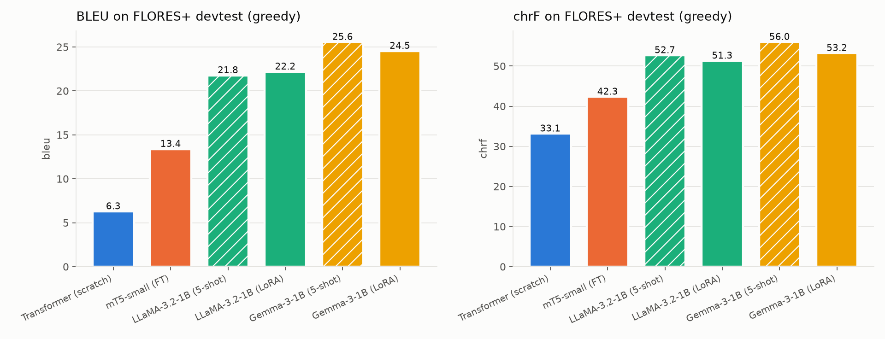
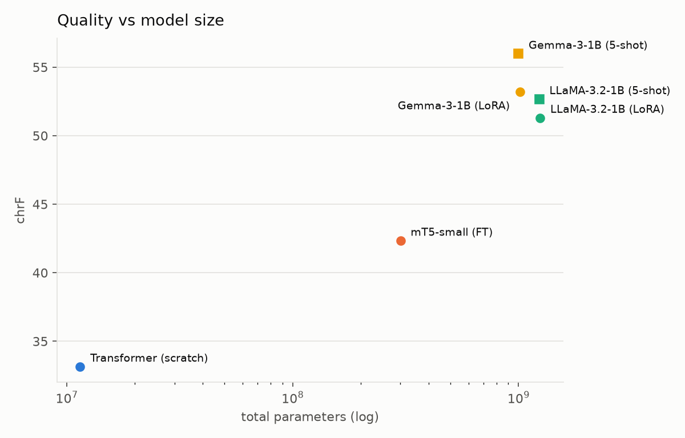
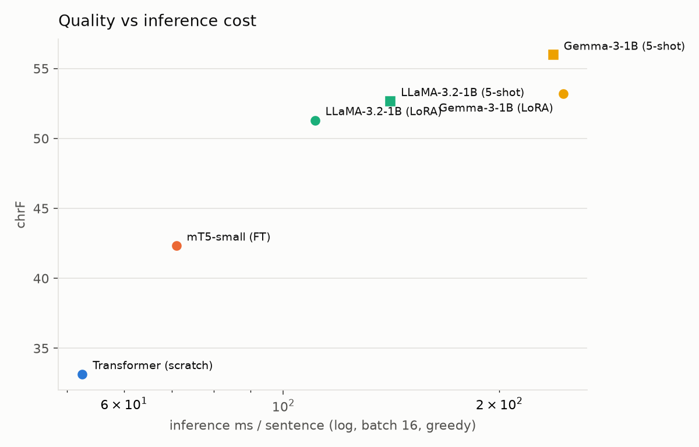
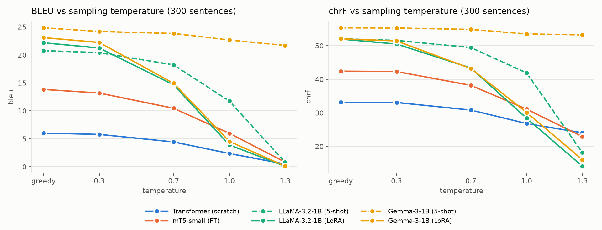

# Übersetzer-Arena

**Comparative English → German machine translation with a Transformer trained from scratch, mT5, LLaMA and Gemma.**
FGAI (ICT4403), Assignment 3, by Unmesh Vardhan (230911030).



---

## 1. Problem statement and objective

Machine translation (MT) can be built in two ways:

- **encoder–decoder (seq2seq)**: one network reads the source and a second one writes the target;
- **decoder-only (LLM)**: a single autoregressive language model is asked to continue a prompt with the translation.

**Objective.** Build English→German MT systems with both architecture families. Translate **the same test set** under comparable settings, and compare them on:

- translation quality (BLEU, chrF);
- training time, inference time and parameter count;
- robustness to the sampling temperature;
- responsible-AI risks (bias, hallucination, cultural misrepresentation, sensitive content).

Finally, name the best model for the task.

## 2. Dataset

| Split                          | Source                                                                   | Size                         | Link                                                           |
| ------------------------------ | ------------------------------------------------------------------------ | ---------------------------- | -------------------------------------------------------------- |
| Train / validation / held-out  | **WMT14 English–German** (`de-en` train), random cleaned sample, seed 42 | 30,000 / 2,000 / 1,000 pairs | <https://huggingface.co/datasets/wmt/wmt14>                    |
| **Test (all reported scores)** | **FLORES+ devtest**, `eng_Latn` → `deu_Latn`                             | 1,012 sentences              | <https://huggingface.co/datasets/openlanguagedata/flores_plus> |
| Few-shot examples              | first 5 pairs with 5–25 words from our validation split                  | 5 pairs                      | (our validation split is carved from WMT14 _train_)            |

**Cleaning** ([`src/data.py`](src/data.py)): 40,000 WMT pairs were sampled. Each pair was Unicode-NFC-normalised, then dropped if it was:

- empty;
- a duplicate (133 dropped);
- longer than 100 words (53);
- out of the length-ratio bound of 3 (680);
- not German by language ID (1,316);
- an exact FLORES sentence, which guards against test leakage (0 found).

From the kept pairs, the first 33,000 were split into train, validation and held-out sets. Mean length is about 23 English words per sentence; statistics are in [`data/stats.json`](data/stats.json).

FLORES+ is professionally translated, multi-domain text (news, travel, science). It is deliberately **out of domain** for models trained on WMT news, so it also measures generalisation.

## 3. Models

| Row            | Model                                                                                     | Architecture    | Adaptation           | Total params | Trainable     |
| -------------- | ----------------------------------------------------------------------------------------- | --------------- | -------------------- | ------------ | ------------- |
| `transformer`  | Hand-written PyTorch Transformer ([`src/transformer_scratch/`](src/transformer_scratch/)) | Encoder–decoder | Trained from scratch | 11.5 M       | 11.5 M        |
| `mt5`          | [`google/mt5-small`](https://huggingface.co/google/mt5-small)                             | Encoder–decoder | Full fine-tuning     | 300.2 M      | 300.2 M       |
| `llama_prompt` | [Llama-3.2-1B-Instruct](https://huggingface.co/meta-llama/Llama-3.2-1B-Instruct)          | Decoder-only    | 5-shot prompting     | 1,235.8 M    | 0             |
| `llama_lora`   | same                                                                                      | Decoder-only    | LoRA fine-tuning     | 1,247.1 M    | 11.3 M (0.9%) |
| `gemma_prompt` | [`google/gemma-3-1b-it`](https://huggingface.co/google/gemma-3-1b-it)                     | Decoder-only    | 5-shot prompting     | 999.9 M      | 0             |
| `gemma_lora`   | same                                                                                      | Decoder-only    | LoRA fine-tuning     | 1,012.9 M    | 13.0 M (1.3%) |

### Transformer (from scratch)

- **Architecture:** 4 + 4 layers, d_model 256, 4 heads, FFN 1024, dropout 0.3, pre-norm, tied embeddings, sinusoidal positions.
- **Tokenizer:** shared 16k SentencePiece unigram.
- **Training:** Noam schedule with 4k warm-up, label smoothing 0.1, token-bucketed batches of 4,096 tokens, early stopping on validation chrF (patience 5, max 30 epochs).
- **Decoding:** greedy, beam-4 with GNMT length penalty, and temperature sampling.

### mT5-small

- Prefix `"translate English to German: "`.
- Adafactor, learning rate 1e-3, effective batch 32, 3 epochs, bf16.
- The best epoch was selected on validation chrF.

### LLaMA / Gemma

- **Prompt:** the model's own chat template with the instruction _"Translate the following English sentence into German. Output only the German translation."_
- **5-shot rows:** five example pairs as previous user/assistant turns.
- **LoRA:** r 16, α 32, dropout 0.05 on all attention and MLP projections. 1 epoch over the 30k pairs: learning rate 2e-4, effective batch 32 (2 × 16 accumulation), max length 256, gradient checkpointing.
- **Training loss** is computed on the assistant (German) tokens only.
- **Output cleaning:** keep the first non-empty line, then strip a `German:` label and surrounding quotes. This changed ≤ 0.8% of greedy outputs (column `postproc_pct`).

**Note on the LLaMA weights.** LLaMA is loaded from [`unsloth/Llama-3.2-1B-Instruct`](https://huggingface.co/unsloth/Llama-3.2-1B-Instruct), an ungated mirror with identical weights and the same Llama 3.2 licence. The official `meta-llama` repo returned 403 while access approval was pending.

## 4. Execution steps and dependencies

**Hardware used:** a single **NVIDIA RTX 3080 Laptop GPU (8 GB)** on Windows 11, with Python 3.13.

**Dependencies** ([`requirements.txt`](requirements.txt); exact versions in [`requirements.lock.txt`](requirements.lock.txt)): torch 2.11 (cu128), transformers 5.21, peft 0.21, datasets, sentencepiece, sacrebleu 2.6, langdetect, pandas, matplotlib, jupyter.

```bash
python -m venv .venv
.venv\Scripts\activate
pip install torch --index-url https://download.pytorch.org/whl/cu128
pip install -r requirements.txt
hf auth login        # Gemma-3 and FLORES+ are gated: accept their licences on Hugging Face first
```

**Run everything.** This is about 9–10 GPU-hours on the laptop above.

```bash
python -m src.data                      # 1. download, clean, split  -> data/
powershell -ExecutionPolicy Bypass -File run_all.ps1   # 2. train all systems, translate FLORES+ (greedy + beam-4),
                                        #    temperature sweep, evaluate        -> checkpoints/, results/
python -m src.rai_probe                 # 3. responsible-AI probe + review sheet -> samples/
                                        #    (keeps existing manual labels for unchanged outputs)
python -m src.plots                     # 4. figures                            -> plots/
jupyter nbconvert --to notebook --execute --inplace notebooks/report.ipynb   # 5. report
```

**Individual steps:**

- **Train one system:** `python -m src.transformer_scratch.train`, `python -m src.train_mt5`, or `python -m src.train_lora --model llama|gemma`. Add `--smoke` for a 2-minute check.
- **Translate:** `python -m src.translate --system gemma_prompt [--beam 4] [--temp 0.7] [--subset 300]`.
- **Score:** `python -m src.evaluate` writes `results/metrics.csv`, `signatures.json` and `fertility.csv`.
- **Tests:** `pytest -m "not slow"` runs 39 tests; `pytest` also runs 4 GPU tests.

**Where the outputs go:**

- **Predictions:** `results/predictions/<row>[_beam4|_t<T>].de`
- **Timings:** `results/timing/`
- **Training logs:** `results/logs/`
- **Figures:** `plots/`
- **Report:** `notebooks/report.ipynb`, plus 20 side-by-side examples in [`samples/side_by_side.md`](samples/side_by_side.md)

## 5. Results

All scores are on the **1,012-sentence FLORES+ devtest**, same GPU, bf16, batch 16, greedy decoding and at most 256 new tokens. They are corpus-level sacrebleu scores (BLEU `tok:13a`; chrF `nc:6, nw:0`; signatures in [`results/signatures.json`](results/signatures.json)). Full table: [`results/metrics.csv`](results/metrics.csv).

| System                 | Arch     | BLEU      | chrF      | BLEU / chrF (beam 4) | Train time | Inference (ms / sent) | Gen. tok/s | Peak VRAM (inference) |
| ---------------------- | -------- | --------- | --------- | -------------------- | ---------- | --------------------- | ---------- | --------------------- |
| Transformer (scratch)  | enc–dec  | 6.28      | 33.14     | 6.26 / 32.01         | 60.5 min   | **52.5**              | **705**    | **0.2 GB**            |
| mT5-small (full FT)    | enc–dec  | 13.38     | 42.33     | 15.17 / 44.72        | 98.3 min   | 71.0                  | 507        | 0.7 GB                |
| LLaMA-3.2-1B, 5-shot   | dec-only | 21.76     | 52.66     | –                    | 0          | 141.1                 | 301        | 3.1 GB                |
| LLaMA-3.2-1B, LoRA     | dec-only | 22.18     | 51.30     | –                    | 118.5 min  | 110.7                 | 355        | 2.6 GB                |
| **Gemma-3-1B, 5-shot** | dec-only | **25.55** | **55.97** | –                    | 0          | 237.8                 | 144        | 2.5 GB                |
| Gemma-3-1B, LoRA       | dec-only | 24.54     | 53.22     | –                    | 163.6 min  | 245.6                 | 135        | 2.1 GB                |

| Quality vs model size                              | Quality vs inference cost                                |
| -------------------------------------------------- | -------------------------------------------------------- |
|  |  |

**Training.**

- **Transformer:** 30 epochs (9,780 steps), best validation chrF 36.2.
- **mT5:** validation chrF 37.6 → 40.9 → 41.8 over 3 epochs.
- **LoRA validation loss:** LLaMA 1.46, Gemma 1.61.

Loss curves are in [`plots/loss_curves.png`](plots/loss_curves.png).

**Tokenization.** Tokens per FLORES sentence ([`plots/fertility.png`](plots/fertility.png)):

| Tokenizer         | English | German |
| ----------------- | ------- | ------ |
| SentencePiece-16k | 32.8    | 36.5   |
| mT5               | 33.4    | 39.6   |
| LLaMA-3.2         | 26.8    | 42.5   |
| Gemma-3           | 26.8    | 35.6   |

German costs LLaMA 58% more tokens than English. Gemma's 262k vocabulary is the most efficient for German, the language that has to be _generated_.

## 6. Comparison and evaluation: encoder–decoder vs decoder-only

1. **Quality: the decoder-only LLMs win clearly.** Even the weakest LLM row (LLaMA LoRA, chrF 51.3) beats the best encoder–decoder (mT5 with beam 4, chrF 44.7) by 6.6 chrF. Gemma 5-shot leads mT5 greedy by 13.6 chrF and 12.2 BLEU.
   - The reason is pretraining scale, not architecture alone. The LLMs saw trillions of tokens including German. mT5-small has 3–4× fewer parameters, and we only fine-tuned it on 30k pairs.
   - The from-scratch Transformer shows the floor. With 30k pairs it learns word order and frequent phrases (validation chrF 36), but it collapses on named entities and rare words. It also loops on 14% of FLORES sentences.
2. **Prompting beat LoRA on this test set.**
   - **Gemma:** LoRA is −1.0 BLEU and −2.8 chrF compared with 5-shot.
   - **LLaMA:** LoRA is +0.4 BLEU but −1.4 chrF.
   - **Why:** LoRA fits WMT _news_ style and its translation conventions, while FLORES is multi-domain. Fine-tuning narrowed a model that was already strong in general.
   - **What LoRA did buy:** shorter prompts. For LLaMA this made inference 22% faster than 5-shot, because the five examples no longer have to be processed for every sentence. For Gemma the two rows are within 4% of each other: single timing runs on a laptop GPU, both with eager attention.
3. **Efficiency: encoder–decoders win by a wide margin.**
   - The Transformer is 87× smaller and 4.5× faster per sentence than Gemma.
   - mT5 is 3.3× faster than Gemma and needs a quarter of the inference memory.
   - The encoder reads the source once, and the small decoder generates cheaply. The decoder-only LLMs re-read prompt + source + output through 1B parameters at every step.
4. **Beam search** helps the fine-tuned mT5 (+1.8 BLEU, +2.4 chrF) but not the under-trained Transformer. Its greedy output is already repetitive, and beam search favours its shorter, generic hypotheses.
5. **Errors.** Automatic error flags (repetition, length, language, untranslated text, numbers; [`results/rai_flags.csv`](results/rai_flags.csv)) fall in the same order as quality:
   - Transformer 27%;
   - mT5 11%;
   - LoRA rows 7%;
   - 5-shot rows 3–4%.

   Number and date errors are the most common flag for every system except the Transformer, whose most common flag is repetition.

**Fairness caveats**

- **Timing.** Gemma runs with eager attention, which it needs here (see _Deviations_), while the other models use SDPA. Gemma's ms/sentence is therefore pessimistic relative to LLaMA.
- **Training-time accounting.** The encoder–decoder train times include per-epoch validation decoding, used for early stopping and checkpoint selection. For mT5 that is about 16 of its 98 minutes (3 × ~5 min); for the Transformer, 30 greedy decodes of 2,000 validation sentences. The LoRA times stop the clock before evaluation.
- **Throughput.** "Gen. tok/s" counts each system's own tokens, and the tokenizers differ (see _Tokenization_). Compare ms/sentence instead.
- **Shared GPU.** Training times were measured on a laptop GPU in its quiet power mode and are indicative only. For about 40 minutes, the first LLaMA LoRA steps shared the GPU with another program.

## 7. Sampling-temperature analysis

Each system re-translated the first 300 FLORES sentences with pure sampling (top-k off, top-p 1.0) at T ∈ {0.3, 0.7, 1.0, 1.3}. Greedy decoding is the T = 0 point. Data: [`results/temp_sweep.csv`](results/temp_sweep.csv).



| BLEU             | greedy   | T 0.3    | T 0.7    | T 1.0    | T 1.3    |
| ---------------- | -------- | -------- | -------- | -------- | -------- |
| Transformer      | 6.0      | 5.8      | 4.4      | 2.4      | 0.5      |
| mT5-small        | 13.8     | 13.2     | 10.5     | 6.0      | 0.8      |
| LLaMA 5-shot     | 20.8     | 20.4     | 18.2     | 11.7     | 0.8      |
| LLaMA LoRA       | 22.2     | 21.2     | 14.7     | 3.9      | 0.1      |
| **Gemma 5-shot** | **24.8** | **24.2** | **23.8** | **22.7** | **21.7** |
| Gemma LoRA       | 23.1     | 22.2     | 14.9     | 4.5      | 0.1      |

**Findings**

- **Greedy (or T ≤ 0.3) is best for every system.** Translation has essentially one correct answer, so sampling only adds noise. Every row's best score is at greedy or T 0.3, and quality drops monotonically after that.
- **LoRA-tuned models are the most temperature-sensitive.** Both fall 7–8 BLEU by T 0.7 and to about 0 BLEU at T 1.3, where they emit multilingual token soup (German, French, Cyrillic, Thai and code fragments mixed together). Our hypothesis, not measured here (an entropy measurement would test it): supervised fine-tuning on 30k references, each with only one acceptable translation, flattens the next-token distribution, so many plausible German tokens get similar probability. Sampling from that flat distribution then wanders off quickly.
- **Gemma 5-shot is remarkably stable.** It loses only 3 BLEU at T 1.3. A likely explanation, also unmeasured, is that its instruction-tuned distribution is very peaked for this task. Sampling is genuinely active: only 12–13 of 300 outputs at T ≥ 1.0 match greedy. LLaMA 5-shot holds until T 0.7 and collapses at 1.3.
- **The encoder–decoders degrade gradually.** chrF stays above 22 even at T 1.3, because a strong source-conditioned encoder keeps outputs on topic even when individual words are sampled badly.
- **Caveat:** decoder-only outputs pass through the first-line clean-up, while encoder–decoder outputs do not. At T 1.3 the clean-up cut 173 of 300 LLaMA-LoRA and 211 of 300 LLaMA 5-shot outputs to their first line, which flatters the decoder rows at high temperature. The conclusions above hold regardless.

**Three sentences across temperatures** (LoRA collapses, 5-shot Gemma only paraphrases):

| English                                                                             | LLaMA LoRA: greedy / T 0.7 / T 1.3                                                                                                                                                                          | Gemma 5-shot: greedy / T 0.7 / T 1.3                                                                                                                                                                                        |
| ----------------------------------------------------------------------------------- | ----------------------------------------------------------------------------------------------------------------------------------------------------------------------------------------------------------- | --------------------------------------------------------------------------------------------------------------------------------------------------------------------------------------------------------------------------- |
| _He built a WiFi door bell, he said._                                               | Er hat ein WiFi-Doormitter gebaut, sagte er. / Er hat ein WLAN-Bell gebaut, sagte er. / _Es hat Ped BUS organisiert и legal Hamburg gebracht buildet auch Yo heltes Rail …_                                 | Er baute eine WLAN-Türklocke, sagte er. / Er hat einen WLAN-Türknauf gebaut, sagte er. / Er hat eine WLAN-Alarmanlage gebaut, sagte er.                                                                                     |
| _In late 2017, Siminoff appeared on shopping television channel QVC._               | Im Jahr 2017 erschien Siminoff auf der Shopping-Show QVC. / _In den späten 90er Jahren begann es, die Nutzungsrechte an den Platten zu verkaufen …_ / _Ende Januar begab Buickuitive Wigille einen Namen …_ | Im Jahr 2017 erschien Siminoff in einem Shopping-Fernsehprogramm von QVC. / Im späten Jahr 2017 erschien Siminoff … / Im Jahr 2017 erschien Siminoff im Shopping-Fernsehstudio QVC.                                         |
| _Ring also settled a lawsuit with competing security company, the ADT Corporation._ | Ring hat auch eine Klage gegen die ADT Corporation … eingereicht. / Ebenfalls zog die Ring an eine umstrittene Konkurrenzbank … / _Nous lanç créoIX胸 slaughterna …_                                        | Auch das Unternehmen, das mit dem Wettbewerber ADT Corporation eine Klage einreichte, wurde beigelegt. / … / Auch das Verfahren wurde mit dem Wettbewerber Sicherheitsunternehmen ADT Corporation außergerichtlich geklärt. |

- **Practical guidance:** use greedy or beam decoding for MT. If you need diverse alternatives (for example, for back-translation data augmentation), use T ≈ 0.3–0.7, and prefer a prompted, instruction-tuned model over a LoRA-tuned one.

## Responsible-AI analysis

Full write-up: [`docs/ethics_analysis.md`](docs/ethics_analysis.md). It draws on a 40-sentence probe set ([`data/rai_probe.tsv`](data/rai_probe.tsv)) covering seven categories, automatic flags on all FLORES outputs, and 96 manually labelled outputs ([`samples/rai_review.csv`](samples/rai_review.csv)). Highlights:

- **Gender bias.** English job titles are ungendered, but German must choose.
  - mT5 and LLaMA-LoRA defaulted to the masculine form even when the source said _her_: _"The doctor finished **her** shift"_ became _"Der Arzt beendete **seine** Arbeit"_.
  - mT5 and Gemma-LoRA feminised _nurse_ (_Krankenschwester_) even with _he_ in the sentence.
  - Gemma-LoRA handled the doctor and pilot cases best (_Ärztin_, _Pilotin_). LLaMA-LoRA used the gender-neutral _Pflegekraft_ in both nurse probes.
- **Hallucination.** Fluent but false content appeared in the LLM outputs:
  - Brzezinski made _"Vice-President of the United States"_;
  - Gaziantep moved from Turkey to _Chad_;
  - _"2023"_ inserted into a 2005 story;
  - _mice_ → _"mouse lovers"_.
- **Repetition and garbling.** The small encoder–decoders fail mostly through repetition loops or garbled output.
- **Cultural misrepresentation.** Idioms were translated literally or invented (_"Es regnet wie aus einem Toaster"_). _Chai_ was flattened to _Tee_; mT5 turned it into _Käse_ (cheese). Gemma-LoRA erased _"Thanksgiving dinner at my grandmother's house"_ entirely.
- **Sensitive content.**
  - mT5 turned _"arrested for stealing food"_ into _"arrested to destroy food"_, an unfair implication.
  - It also turned _anxiety_ into _apathy_.
  - LLaMA-LoRA silently dropped an insult, which is softening the translation should not do.
- **Mitigations:**
  - gender-neutral or both-forms output when the source is ambiguous;
  - number and entity consistency checks, plus placeholder masking;
  - greedy decoding;
  - length-ratio and language-ID filters (these caught a real pipeline bug here);
  - quality estimation, with human post-editing for medical, legal and criminal text;
  - a user-selectable _Sie/du_ register;
  - fine-tuning data that matches the target domain.

## 8. Conclusion

**Best model: Gemma-3-1B-it with 5-shot prompting.** It has:

- the highest BLEU (**25.55**) and chrF (**55.97**) on FLORES+ devtest;
- the lowest automatic error-flag rate (3.0%);
- by far the most robust behaviour under temperature sampling;
- no training cost at all.

**Trade-offs.**

- **Speed:** it is the slowest system, at 238 ms per sentence and 2.5 GB of GPU memory.
- **Under latency or memory limits, mT5-small with beam 4 is the better choice.** It reaches chrF 44.7 at 71 ms per sentence with under 1 GB.
- **Encoder–decoder vs decoder-only:** at this scale, pretrained decoder-only LLMs give clearly better translations, and encoder–decoders give much cheaper ones.
- **LoRA on a 30k-pair news sample did not beat prompting on out-of-domain text.** Fine-tuning helps when its data matches the deployment domain.

## Deviations from the plan and limitations

- **Language pair.** The pair was switched from English→Telugu to English→German to fit a two-day deadline. German has abundant clean parallel data, and a fluent-speaker check was less critical.
- **mT5 optimiser and memory.** mT5 used Adafactor (lr 1e-3) instead of AdamW, whose memory peaked at 12.3 GB on an 8 GB GPU.
- **mT5 resume.** Training stalled after epoch 1, when Windows started paging GPU memory to system RAM. It resumed from the epoch-1 checkpoint with micro-batch 4 × 8 accumulation instead of 8 × 4. The effective batch of 32 is unchanged.
  - The reported training time adds the 25 minutes spent before the stall.
  - The loss curve is normalised for the accumulation change. The trainer logs mT5 loss summed over accumulation steps.
  - The summed loss also scaled mT5's gradients: ×4 in epoch 1 and ×8 after the resume. Adafactor's update normalisation and gradient clipping at 1.0 largely absorb this, and no reported metric depends on it.
- **LoRA micro-batch.** LoRA micro-batch is 2 (×16 accumulation) to avoid the same memory paging.
- **Gemma attention.** Gemma inference uses `eager` attention. With SDPA, batched generation turned whole batches into unrelated French text (29 of 1,012 sentences in the first run). This was fixed, all Gemma rows were re-run, and a regression test guards it ([`tests/test_gemma_batch.py`](tests/test_gemma_batch.py)).
- **Scope.**
  - Each system was trained once with one seed (42), with no hyper-parameter search; the differences of about 1 BLEU between LLM rows are within run-to-run noise.
  - The LLMs (≈1B) are larger than mT5-small (300M), so this is not a size-matched architecture comparison.
- **Ethics review.** The ethics labels were AI-assisted (drafted with Claude) and spot-checked by the author. The probe set is small and illustrative.

## Repository layout

```
src/            data.py, transformer_scratch/, train_mt5.py, train_lora.py, prompts.py, translate.py,
                evaluate.py, temperature_sweep.py, rai_probe.py, plots.py, common.py
configs/        one YAML per system row
data/           cleaned splits, FLORES+ devtest, stats.json, rai_probe.tsv
results/        metrics.csv, temp_sweep.csv, rai_flags.csv, predictions/, timing/, logs/
plots/          all figures in this README
samples/        rai_probe.csv, rai_review.csv (labelled), side_by_side.md
notebooks/      report.ipynb (reads results only)
docs/           ethics_analysis.md, design spec and implementation plan
tests/          pytest suite (43 tests; 4 marked slow need the GPU)
submission/     LMS document generator and the generated .docx/.pdf
```

Model checkpoints (3.6 GB) are not committed. Re-create them with step 2 above.
